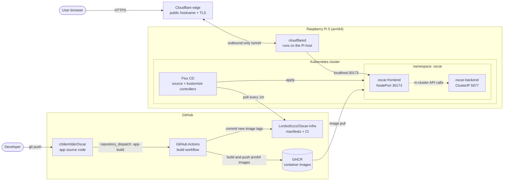
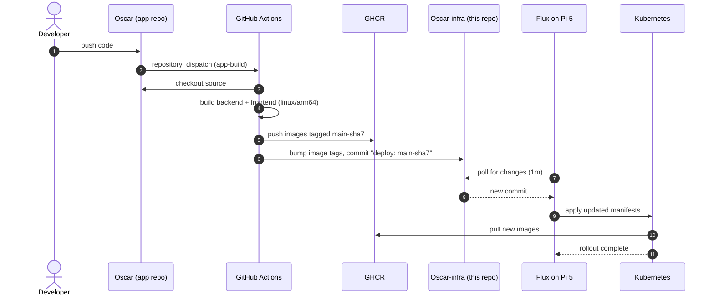
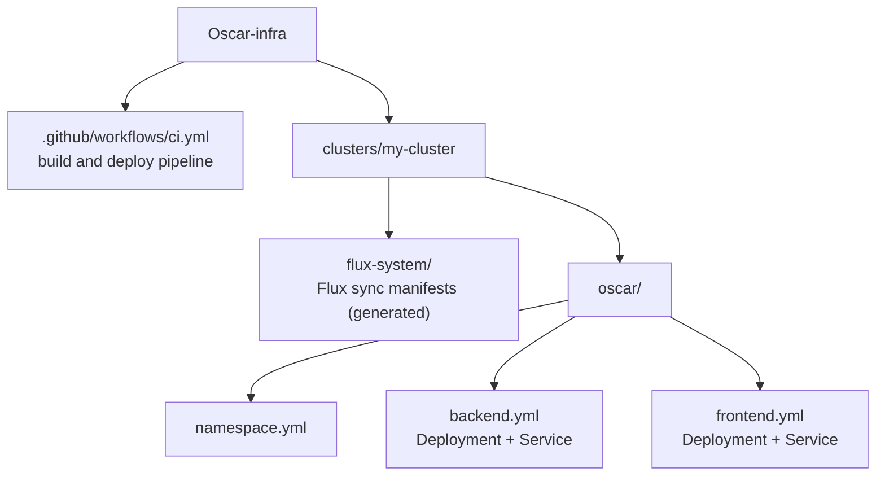
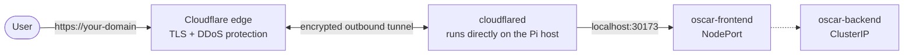

<div align="center">

# Oscar-infra

**End-to-end GitOps pipeline running on a Raspberry Pi 5**

Push code, get a built arm64 image, and watch Flux roll it out to a self-hosted Kubernetes cluster. No manual `kubectl apply`.


-C51A4A?logo=raspberrypi&logoColor=white)

</div>

---

## Overview

This repository is the **infrastructure and deployment layer** for [Oscar](https://github.com/c0dem0de/Oscar), a two-tier web application (backend API + web frontend). It contains:

- Kubernetes manifests for the app, managed declaratively with **Flux CD**
- A **GitHub Actions** pipeline that builds multi-service container images and updates the manifests automatically
- Everything needed to rebuild the cluster state from Git alone

Both Flux and the application run on a single **Raspberry Pi 5**, so the whole delivery loop is self-hosted, low-cost, and reproducible. The app is exposed to the internet through a **Cloudflare Tunnel**, so the Pi needs no open inbound ports and no port forwarding on the home router.

## Architecture



## CI/CD flow



Git is the single source of truth. To change what runs in the cluster, change a manifest here and let Flux apply it.

## Tech stack

| Layer | Tool |
| --- | --- |
| Hardware | Raspberry Pi 5 (arm64) |
| Orchestration | Kubernetes |
| GitOps controller | Flux CD |
| CI | GitHub Actions (Buildx + QEMU) |
| Container registry | GitHub Container Registry (GHCR) |
| Public access | Cloudflare Tunnel (`cloudflared`) |
| Config | Plain Kubernetes YAML + Kustomize (via Flux) |

## Repository layout



## Workloads

| Component | Image | Port | Exposure |
| --- | --- | --- | --- |
| `oscar-backend` | `ghcr.io/lordsofzzzz/oscar-backend` | 5677 | ClusterIP (internal only) |
| `oscar-frontend` | `ghcr.io/lordsofzzzz/oscar-frontend` | 80 | NodePort `30173` |

Both run in the `oscar` namespace with TCP readiness and liveness probes and resource requests and limits sized for a Pi.

| Component | CPU request | Memory request | Memory limit |
| --- | --- | --- | --- |
| backend | 50m | 128Mi | 512Mi |
| frontend | 25m | 64Mi | 256Mi |

**Access**
- Public: through the Cloudflare Tunnel hostname (HTTPS, terminated at Cloudflare's edge).
- Local network: `http://<pi-ip>:30173`.

## Public access with Cloudflare Tunnel

The Pi sits behind a home network, so instead of port forwarding, `cloudflared`, which runs directly on the Pi host (not as a pod), opens an **outbound** connection to Cloudflare. Cloudflare routes requests for the public hostname through that tunnel to the frontend NodePort on the Pi.



Why a tunnel:
- No inbound ports opened on the router, so the Pi's IP is never exposed.
- Works behind CGNAT and dynamic IPs.
- TLS certificates and DDoS protection come from Cloudflare at no extra setup.
- The backend stays internal (`ClusterIP`) and is never published directly.

## Pipeline details

Workflow: [`.github/workflows/ci.yml`](.github/workflows/ci.yml)

**Triggers**
- `repository_dispatch` of type `app-build`, sent by the app repo
- `workflow_dispatch` for manual runs from the Actions tab

**What it does**
1. Checks out the private app repo using a read-only token.
2. Logs in to GHCR with the built-in `GITHUB_TOKEN`.
3. Derives the image tag `main-<7-char app commit SHA>`, so every image maps back to an exact source commit.
4. Builds and pushes backend and frontend images for `linux/arm64`.
5. Rewrites the `image:` lines in the manifests and pushes a `deploy: <tag>` commit as `ci-bot`.

**Required secret**

| Secret | Purpose |
| --- | --- |
| `APP_REPO_READ_TOKEN` | Read access to the private app repo |

## Flux configuration

Defined in `clusters/my-cluster/flux-system/gotk-sync.yaml`:

| Setting | Value |
| --- | --- |
| Git source | `ssh://git@github.com/Lordsofzzzz/Oscar-infra` (branch `main`) |
| Source poll interval | 1 minute |
| Kustomization path | `./clusters/my-cluster` |
| Reconcile interval | 10 minutes |
| Pruning | Enabled. Resources removed from Git are removed from the cluster |

## Getting started

**Prerequisites**
- Raspberry Pi 5 (or any arm64 host) running Kubernetes
- `kubectl` and the [`flux` CLI](https://fluxcd.io/flux/installation/)
- A GitHub token or deploy key Flux can use

**Bootstrap Flux**

```bash
flux bootstrap github \
  --owner=Lordsofzzzz \
  --repository=Oscar-infra \
  --branch=main \
  --path=clusters/my-cluster
```

Flux installs itself, then reconciles everything under `clusters/my-cluster`, including the `oscar` namespace and both workloads.

## Operations

```bash
# Overall Flux health
flux get kustomizations
flux get sources git

# App status
kubectl -n oscar get pods,svc
kubectl -n oscar logs deploy/oscar-backend

# Force an immediate sync
flux reconcile source git flux-system
flux reconcile kustomization flux-system
```

| Task | How |
| --- | --- |
| Deploy a new version | Push to the app repo, or run the `build` workflow manually |
| Roll back | `git revert` the `deploy:` commit on `main`. Flux applies the previous tag |
| Scale or tune resources | Edit the manifest, commit, and let Flux apply it |

## Design decisions

- **GitOps over push-based deploys.** The cluster pulls its desired state from Git. No cluster credentials are stored in CI, and every change is auditable and revertable.
- **Separate app and infra repos.** Application code and deployment config change at different rates and need different access controls.
- **Immutable, traceable tags.** Images are tagged with the source commit SHA, never `latest`, so a running pod always maps to an exact commit.
- **Native arm64 images.** Built with Buildx and QEMU for the Pi 5, avoiding emulation at runtime.
- **Zero inbound exposure.** Cloudflare Tunnel uses outbound connections only, which removes router port forwarding and hides the Pi's real IP.
- **Right-sized resources.** Requests and memory limits keep both services predictable on a small single-node cluster.

## Notes

- CI rewrites image tags with `sed`. Keep the `image: ghcr.io/lordsofzzzz/oscar-<service>:<tag>` line format intact.
- The backend port `5677` appears several times in `backend.yml`. Change all occurrences together.
- Do not hand-edit generated files in `flux-system/`.

## Roadmap

- [ ] Ingress controller behind the tunnel instead of a raw NodePort
- [ ] Move `cloudflared` into the cluster as a Flux-managed Deployment
- [ ] Encrypted secrets with SOPS or Sealed Secrets
- [ ] Monitoring with Prometheus and Grafana
- [ ] Image update automation and rollout notifications
- [ ] Staging environment

## License

TODO: add a license.
